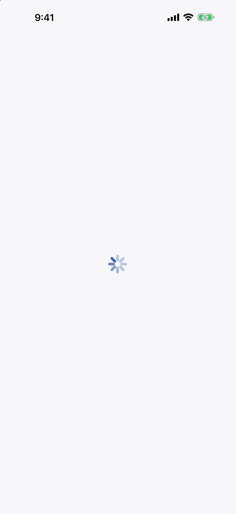
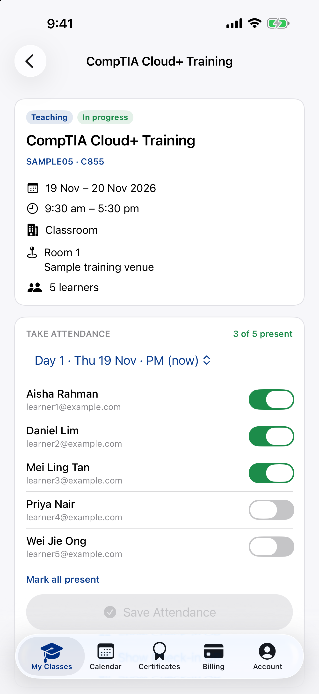
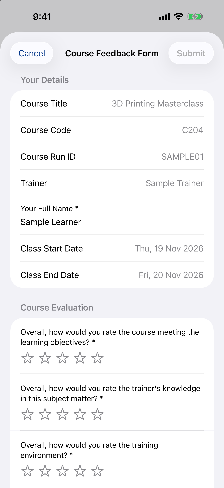
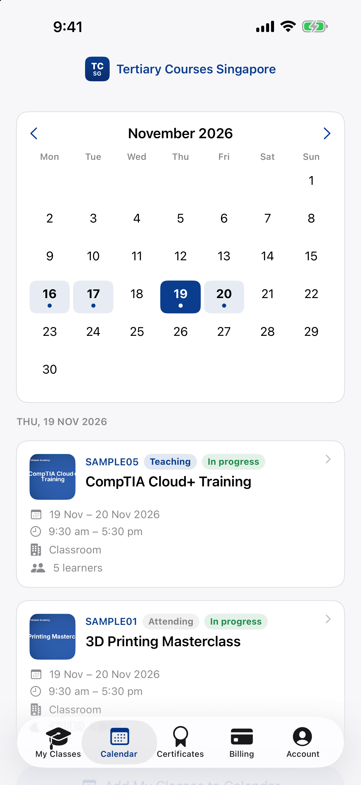

# TC LMS SG — Tertiary Courses Singapore learner app (iOS)

[](https://apps.apple.com/app/tertiary-courses/id6787036413)

Native SwiftUI app for **learners and trainers** of
[Tertiary Courses Singapore](https://www.tertiarycourses.com.sg/). It is the
phone version of the LMS on www.tertiarycourses.com.sg.

- **Sign in** with an emailed one-time code or the website password (learner or trainer login).
- **My Classes** — current, upcoming and past classes; venue / online link. A trainer sees the
  classes they teach (WSQ and non-WSQ) beside the classes they attend, tagged Teaching / Attending.
- **Trainer class view** — take attendance per session, show the check-in QR, trainer and learner
  materials, feedback response count.
- **Digital attendance** — learners check in to the current session.
- **Class reminders** — local notifications 3 days before, the evening before each class day and an
  hour before class (no push service; scheduled on the device from the class list).
- **Class materials** — slides, learner guide, lesson plan, labs and certificates open in an in-app viewer.
- **In-house feedback survey** — the site's own course survey, once per class.
- **Calendar** — class days by month; add them to the iPhone calendar.
- **Certificates** and **Billing** — certificate PDFs; registrations and payment status.
- **Profile** — edit name and phone; Light / Dark / System appearance saved to the account.
- **Courses** — the public non-WSQ catalog; **account deletion** in Account.

## Sister apps

The same code ships as three apps; only `TertiaryCoursesApp/Site.swift`,
`project.yml`, the icon and the bundled catalog differ.

| App | Site | Repo |
|---|---|---|
| TC LMS SG | www.tertiarycourses.com.sg | this repo (shared source lives here) |
| TC LMS MY | www.tertiarycourses.com.my | `tertiarycoursesmyapp` |
| TC LMS GH | www.tertiarycourses.com.gh | `tertiarycoursesghapp` |

After changing shared code here, run `scripts/sync_variant.sh ../tertiarycoursesmyapp`
(and `…ghapp`) to copy it across.

## Backend

Each app talks only to its own site's `/mobileapi/*` JSON API (module
`MMD_MobileApi` in the `ai-mms` storefront, documented in its
`docs/mobile-learner-api.md`). No keys are shipped in the app; learners
authenticate with their own account and get a bearer token kept in the Keychain.

## Build

Requires Xcode 26 and XcodeGen. Minimum iOS 17.

```sh
xcodegen generate
xcodebuild -project TertiaryCourses.xcodeproj -scheme TertiaryCourses \
  -destination 'platform=iOS Simulator,name=iPhone 17 Pro Max' build
```

- `scripts/make_icon.swift SG <out.png>` — renders the TC LMS icon.
- `scripts/snapshot_catalog.sh` — refreshes the bundled offline catalog from the site.
- `scripts/screenshots.sh <dir> <simulator-udid>` — App Store screenshots using the App Review sample account.

## Preview

| My Classes | Teaching a class | Feedback | Calendar |
|---|---|---|---|
|  |  |  |  |
